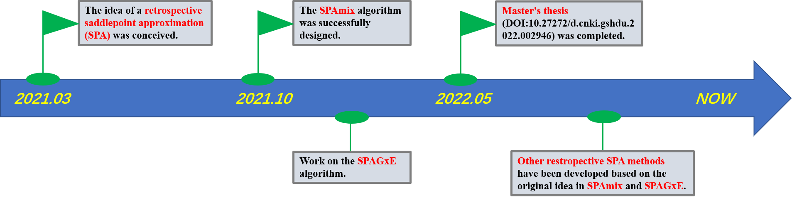

# Introduction of retrospective saddlepoint approximation (retrospective SPA) approach in GWAS

## What is retrospective SPA?

**Retrospective saddlepoint approximation (Retrospective SPA)** is a method applied in GWAS. For a score statistic (S=**G**<sup>T</sup>**R**), retrospective SPA strategy
- (1) considers genotypes as random variables. 
- (2) uses saddlepoint approximation (SPA) to accurately approximate the null distribution of score statistics conditional on phenotype and covariates.

**Our original contribution is the strategy of applying saddlepoint approximation (SPA) to retrospective score statistics**, first presented in Yuzhuo Ma’s master’s research and documented in his 2022 thesis. The innovation is this retrospective–SPA combination, rather than retrospective association analysis or SPA in isolation. This strategy has its own statistical formulation and should not be described simply as an extension of a prospective-SPA algorithm.

## Main features of GWAS methods based on retrospective SPA strategy

- Applicable to a wide range of trait types (binary, quantitative, time-to-event, ordinal, longitudinal, and other traits).

- Maintain high accuracy when testing low-frequency or rare variants, even when the phenotypic distribution is unbalanced (e.g. case-control imbalance in case-control studies).

## Citation of retrospective SPA

The strategy of applying SPA to retrospective score statistics was first presented in Yuzhuo Ma's master's research and documented in the following thesis:

- [马雨茁.经验鞍点近似方法及其在全基因组关联分析中的应用研究.2022.山东大学,MA thesis.](https://kns.cnki.net/kcms2/article/abstract?v=jkwd3qsBIEKwkKkgMuimTLSEojAEBaWSJzCAd3uOCepX09aaYi1Vhn87HddxnsydAW9MGQHzgdF9Nw93IZ_DZCdJbGAX3C13DfGxpW58VBV273z1eVlg75Je1akPxIDc5iiSpz46iutS1tt9m3MJRg==&uniplatform=NZKPT&language=CHS)

- **DOI:10.27272/d.cnki.gshdu.2022.002946**

Based on the idea from the authors of the above master's thesis, we have applied retrospective saddlepoint approximation to several methods including:

- [```SPAmix```](https://github.com/YuzhuoMa97/SPAmix) (the original retrospective-SPA GWAS method, developed since 2021)
- [```SPAmix+```](https://github.com/YuzhuoMa97/SPAmixPlus) (based on ```SPAmix``` since 2024)
- [```SPAmix-Gene```](approach_SPAmix_GENE.html) (based on ```SPAmix``` since 2024)
- [```SPAmix-QRS```](https://github.com/YuzhuoMa97/SPAmix-QRS) (based on ```SPAmix``` since 2025)
- [```SPAmix-QRS+```](https://github.com/YuzhuoMa97/SPAmix-QRSplus) (based on ```SPAmix``` since 2025)
- [```WtCoxG```](https://doi.org/10.1038/s43588-025-00864-z) (based on ```retrospective-SPA``` since 2022). 
- [```SPAGxE```](https://github.com/YuzhuoMa97/SPAGxECCT) (the original retrospective-SPA GxE method since 2021)
- [```SPAGxE+```](https://github.com/YuzhuoMa97/SPAGxECCT) (based on ```retrospective-SPA``` since 2021)
- [```SPAGxEmixCCT```](https://github.com/YuzhuoMa97/SPAGxECCT) (based on ```retrospective-SPA``` since 2021)
- [```SPAGxEmix+```](https://github.com/YuzhuoMa97/SPAGxECCT) (based on ```retrospective-SPA``` since 2024). 
- [```WtGxE```](https://github.com/YuzhuoMa97/WtGxE) (based on ```retrospective-SPA``` since 2025). 
- [```SPAGxEmix-QRS```](https://github.com/YuzhuoMa97/SPAmix-QRS) (based on ```SPAmix``` and ```SPAGxE``` since 2026)
- [```SPAGxEmix-QRS+```](https://github.com/YuzhuoMa97/SPAmix-QRSplus) (based on ```SPAmix``` and ```SPAGxE``` since 2026)


**If you use this retrospective–SPA strategy or its methods, please cite the relevant [SPAmix paper](https://doi.org/10.1186/s13059-025-03827-9) or [SPAGxE paper](https://doi.org/10.1038/s41467-025-57887-3), and acknowledge the original thesis when discussing the strategy’s origins. We welcome applications, methodological developments and collaboration.**

- **[马雨茁.经验鞍点近似方法及其在全基因组关联分析中的应用研究.2022.山东大学,MA thesis.](https://kns.cnki.net/kcms2/article/abstract?v=jkwd3qsBIEKwkKkgMuimTLSEojAEBaWSJzCAd3uOCepX09aaYi1Vhn87HddxnsydAW9MGQHzgdF9Nw93IZ_DZCdJbGAX3C13DfGxpW58VBV273z1eVlg75Je1akPxIDc5iiSpz46iutS1tt9m3MJRg==&uniplatform=NZKPT&language=CHS)**

- **MLA format citation:** ```[1] 马雨茁.经验鞍点近似方法及其在全基因组关联分析中的应用研究. 2022. 山东大学, MA thesis.```

- **DOI:** ```10.27272/d.cnki.gshdu.2022.002946```

**in accordance with academic standards.**

## Published papers and questions

The two papers presenting this retrospective–SPA strategy in GWAS and G×E analysis have now been published:

- **SPAmix:** Ma, Y., Xu, H., Li, Y., et al. (2025). SPAmix: a scalable, accurate, and universal analysis framework for large-scale genetic association studies in admixed populations. *Genome Biology*, **26**, 356. [DOI:10.1186/s13059-025-03827-9](https://doi.org/10.1186/s13059-025-03827-9).
- **SPAGxE:** Ma, Y., Zhao, Y., Zhang, J.-F., and Bi, W. (2025). Efficient and accurate framework for genome-wide gene-environment interaction analysis in large-scale biobanks. *Nature Communications*, **16**, 3064. [DOI:10.1038/s41467-025-57887-3](https://doi.org/10.1038/s41467-025-57887-3).

The combination of retrospective score statistics and SPA remains the methodological idea emphasized here. Suggestions, questions and collaboration are welcome at [yuzhuoma@amss.ac.cn](mailto:yuzhuoma@amss.ac.cn).

## Timeline of the Retrospective SPA Project

### March 2021
- **Event**: The idea of a retrospective saddlepoint approximation (SPA) was conceived.

### October 2021
- **Event**: The SPAmix algorithm was successfully designed.

### October 2021 - February 2022
- **Event**: Work on the SPAGxE algorithm was initiated.

### May 2022
- **Event**: The master's thesis (DOI:10.27272/d.cnki.gshdu.2022.002946), which initially introduced the concept of retrospective SPA, was completed.





