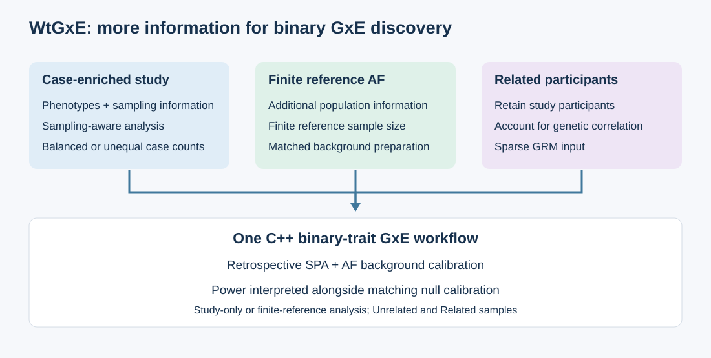

# WtGxE for binary gene-environment interaction analysis

WtGxE is a standalone C++ program for genome-wide gene-environment interaction
(GxE) analysis of binary traits. It **adjusts for genetic relatedness** through
a sparse genetic relationship matrix (GRM), allowing related participants to
contribute to the analysis without requiring pedigree-role labels.

Its goal is **greater GxE detection power with calibrated type one error
rate**, through effective use of **case-enriched study data, finite external
allele-frequency (AF) information, and related participants**. These
complementary information sources support association discovery in one workflow.

The method builds on the retrospective analysis and saddlepoint approximation
(SPA) line of work described in Yuzhuo Ma's
[master's thesis (2022; DOI:10.27272/d.cnki.gshdu.2022.002946)](https://doi.org/10.27272/d.cnki.gshdu.2022.002946)
and [Ma et al., Nature Communications (2025)](https://doi.org/10.1038/s41467-025-57887-3).
WtGxE brings this framework together with sampling-aware analysis, finite
reference AF and sparse-GRM relatedness input in one C++ workflow.

## Three information channels for GxE discovery

|Information source|WtGxE capability|Contribution to GxE discovery|
|---|---|---|
|Related participants|Adjusts for genetic relatedness using a sparse GRM|Retains phenotyped participants who would be excluded by an unrelated-only analysis, while accounting for their correlation|
|Case-enriched study data|Accounts for case-control ascertainment using sampling information|Uses the information in the selected study while relating it to its target population|
|Finite external AF|Incorporates additional population AF information and its reference sample size|Can improve power beyond study-only AF; gains have been demonstrated in selected evaluated settings|

**Case oversampling does not require more cases than controls.** It means that
the sampled case fraction is higher than population prevalence. A study with
5,000 cases and 5,000 controls can therefore be case-enriched, as can a study
with more controls than cases.

These channels contribute different information. Reference participants add AF
information rather than additional study phenotypes. Relatedness adjustment
accounts for correlation rather than treating relatives as independent
replicates. Their combination is intended to improve the effective use of
the available genetic study and reference resources.

## Power with calibrated inference

Power is useful only when null associations are properly calibrated. WtGxE
therefore couples its sampling-aware workflow with retrospective SPA and
explicit analysis status. The external-AF workflow also includes heldout
background calibration to address study-reference AF discrepancies.
Power comparisons are interpreted together with matching null simulations.

The same input interface supports unrelated and related study samples and
offers study-only or finite-reference-AF analysis. Users provide a binary
phenotype, an environmental measurement, selected covariates and sampling
information; relatedness is supplied through a sparse GRM. Detailed file
requirements are provided in the usage manual.

## C++ software and worked example

The [WtGxE source repository](https://github.com/YuzhuoMa97/WtGxE) contains the
independent C++ package, bundled Eigen headers, documentation and artificial
example data. Repository access is required to retrieve the source.
The executable runs independently of an R or Python analysis session.

1. Follow the [installation guide](wtgxe_cpp/installation.html) for CMake or a direct C++17 build.
2. Download the [synthetic example inputs](assets/wtgxe/WtGxE-example-inputs.zip).
3. Run the [two-step worked example](wtgxe_cpp/quickstart.html): prepare background AF summaries, then analyze target variants.
4. Consult [input and output formats](wtgxe_cpp/input_formats.html) to adapt the workflow to a study.

The [C++ manual](wtgxe_cpp/index.html) brings the installation, background
preparation and analysis steps together. The example uses 400 artificial
participants, heldout background variants and four target variants, allowing
users to learn the interface before preparing their own study inputs.

## Academic background and software citation

Please record the WtGxE software version used in an analysis and cite the
relevant methodological background:

- **WtGxE:** Ma, Y., et al. *WtGxE: efficiently leveraging external allele frequency and weighted logistic regression to improve power in genome-wide gene-environment interaction studies.*
- Yuzhuo Ma. Master's thesis (2022). [DOI:10.27272/d.cnki.gshdu.2022.002946](https://doi.org/10.27272/d.cnki.gshdu.2022.002946).
- Ma, Y., Zhao, Y., Zhang, J.-F., and Bi, W. (2025). Efficient and accurate framework for genome-wide gene-environment interaction analysis in large-scale biobanks. *Nature Communications*, 16, 3064. [DOI:10.1038/s41467-025-57887-3](https://doi.org/10.1038/s41467-025-57887-3).
- Li, Y., Ma, Y., Xu, H., et al. (2025). Applying weighted Cox regression to genome-wide association studies of time-to-event phenotypes. *Nature Computational Science*, 5, 1064-1079. [DOI:10.1038/s43588-025-00864-z](https://doi.org/10.1038/s43588-025-00864-z).

Software redistribution is governed by the repository
[LICENSE](https://github.com/YuzhuoMa97/WtGxE/blob/main/LICENSE) and applicable
incorporated-source notices. Academic attribution and contact details do not
replace those license terms.

## Contact

For software access, installation, scientific questions or collaboration,
please contact [yuzhuoma@amss.ac.cn](mailto:yuzhuoma@amss.ac.cn).
